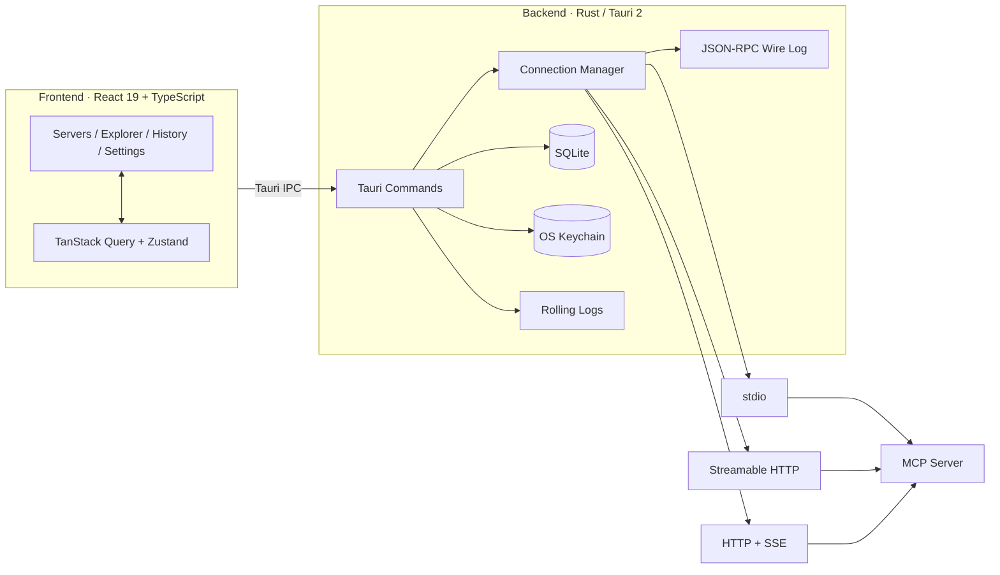

<div align="center">
  
</div>

<h1 align="center">MCP Tester</h1>

<p align="center">
  <strong>A desktop client for testing MCP servers</strong><br />
  Connect to any MCP server, inspect its capabilities, invoke tools with generated forms, watch JSON-RPC traffic, and replay past calls.
</p>

<p align="center">
  <a href="README.md">简体中文</a> · <strong>English</strong>
</p>

<p align="center">
  <a href="https://tauri.app/"></a>
  <a href="https://react.dev/"></a>
  <a href="https://www.rust-lang.org/"></a>
  <a href="https://modelcontextprotocol.io/"></a>
  <a href="#requirements"></a>
  <a href="../../releases"></a>
  <a href="LICENSE"></a>
</p>

<p align="center">
  <a href="#features">Features</a> ·
  <a href="#quick-start">Quick Start</a> ·
  <a href="#usage">Usage</a> ·
  <a href="#startup-configuration">Startup Configuration</a> ·
  <a href="#data-and-portable-mode">Data and Portable Mode</a> ·
  <a href="#security">Security</a> ·
  <a href="#development">Development</a>
</p>

MCP Tester is a desktop debugging tool for the **Model Context Protocol (MCP)**. It combines server management, capability discovery, schema-driven invocation, JSON-RPC wire inspection, and call replay in a single UI. It is designed for local `stdio` servers, remote `Streamable HTTP` servers, and legacy `HTTP + SSE` servers.

> [!NOTE]
> Current version: **v0.1.3**. Windows is the primary release target, and the project is under active development.

## Features

| Area | What you can do |
| --- | --- |
| **Server management** | Add, edit, and delete `stdio`, `Streamable HTTP`, and `HTTP + SSE` servers; connect, disconnect, reconnect, and probe; test a connection before saving with a step-by-step handshake, protocol version, and capability counts. |
| **API explorer** | Enumerate Tools, Resources, Resource Templates, and Prompts; search by name, description, or URI; automatically refresh when the server sends a list-changed notification. |
| **Schema forms** | Generate forms from a tool's `inputSchema`, with required, type, and enum validation; switch to raw JSON editing; explicitly choose "Send anyway" when validation fails. |
| **Invocation and cancellation** | Call `tools/call`, `resources/read`, and `prompts/get`; cancel in-flight calls; extract and validate URI template variables. |
| **Result viewer** | Render MCP content blocks including text, Markdown, images, audio, resources, links, and structured JSON; switch between rendered, tree, and raw views; copy values with one click. |
| **Traffic inspector** | Pair JSON-RPC requests and responses by id, with duration, size, and status; filter by method, keyword, or errors; pause, follow the latest traffic, and export. View server notifications and stdio `stderr` in separate tabs. |
| **History and replay** | Persist calls in SQLite; filter by server, method, status, or keyword; replay a call in the Explorer with one click; delete, clear, or export history as JSON. |
| **Import and export** | Recognize Claude Desktop / Cursor `mcpServers` and VS Code `servers` formats; mask secrets when exporting server configuration. |
| **Startup configuration** | Pre-seed servers, a default server, and auto-connect through `mcptester.config.json`; add missing entries without overwriting user changes. |
| **Portable and secure** | Store credentials in the OS keychain for installed builds; keep portable data beside the executable; redact sensitive log fields; spill large results to disk. |

Design goals:

- **Observable**: see the full JSON-RPC round trip, notifications, and process output, not just the final result.
- **Reproducible**: replay parameters and results to investigate intermittent failures and verify fixes.
- **Portable**: import and export server configuration between MCP Tester, Claude Desktop, Cursor, and VS Code formats.

## Quick Start

### Download

Download the latest build from [Releases](../../releases).

| Build | Best for | Data and credentials |
| --- | --- | --- |
| **MSI installer** | Daily use, standard install and uninstall | Data in the user data directory; secrets in the OS keychain |
| **Portable ZIP** | No installation, removable media, isolated environments | Data in `data/` next to the executable; secrets stored as plaintext in the local database |

> [!WARNING]
> Portable builds store headers and environment variables as plaintext in `data/mcptester.db`. Do not share a portable folder containing real credentials. The MSI is currently unsigned, so Windows SmartScreen may warn on first launch.

### Requirements

| Requirement | Details |
| --- | --- |
| Operating system | Windows 10 / 11 (x64) |
| WebView2 | Built into Windows 11; Windows 10 may require the WebView2 Runtime |
| Node.js | 20 or newer |
| pnpm | 9 or newer (the repository uses `pnpm-lock.yaml`) |
| Rust | Stable, with edition 2024 support |
| Build tools | Visual Studio Build Tools with "Desktop development with C++" |

### Run from source

```bash
pnpm install
pnpm tauri dev
```

The first run downloads and compiles Rust dependencies, which can take a while depending on your network and machine.

### Build and package

```bash
pnpm build        # TypeScript type-check + frontend build
pnpm tauri build  # build the MSI
```

The MSI is written to `src-tauri/target/release/bundle/msi/`.

To build a portable copy manually:

```powershell
pnpm tauri build --no-bundle
# Copy src-tauri/target/release/mcptester.exe to a target folder
# Create an empty mcptester.portable file next to it to enable portable mode
```

## Usage

### 1. Add and connect a server

- Open **Servers** and click **New server**.
- `stdio`: provide the command, one argument per line, environment variables, and working directory. Keep the command resolution mode on `resolve`; `cmd_shell` has escaping risks; `never` is mainly for troubleshooting.
- `HTTP / SSE`: provide the MCP endpoint URL, headers, and an optional timeout override. Enable "Allow insecure TLS" only for local self-signed certificates.
- `Authorization` accepts either a full `Bearer xxx` value or a bare token; the client normalizes both.
- **Test connection** validates the configuration without saving it or writing history. After saving, click **Connect**, then open **Explorer** to discover capabilities.

### 2. Explore and invoke

- Open **Explorer**, select a connected server, and refresh capabilities if needed.
- Tabs cover Tools, Resources, Resource Templates, and Prompts; the left-hand list supports keyword search.
- Tool forms are generated from the JSON Schema; switch to JSON mode to edit arguments directly.
- Missing required fields or type mismatches block sending by default. Choose **Send anyway** to bypass client-side validation; this option is not offered when JSON parsing fails.
- Resource templates extract `{variables}` and require all values before reading. In-flight calls can be cancelled.

### 3. Inspect results

- The result header shows status, duration, protocol version, transport, timestamp, and size.
- **Rendered** displays MCP content blocks; **Tree** shows the JSON structure; **Raw** preserves the original response.
- Results larger than 1 MB are truncated in the database. The full payload is written to `data/results/<record-id>.json` and can be opened from the result view.

### 4. Inspect traffic

- Expand the **Event panel** at the bottom of the Explorer.
- The **Wire** tab pairs requests and responses by JSON-RPC id and shows direction, duration, size, and status. Filter by method, keyword, or errors.
- Pause, follow the latest traffic, clear, or export the wire log. Server notifications and stdio `stderr` have their own tabs.
- When the server sends a `*/list_changed` notification, the capability list refreshes automatically.

### 5. History and replay

- **History** records tool calls, resource reads, prompt requests, and probes.
- Filter by server, method, status, or keyword, then inspect the full parameters and result.
- **Load in Explorer** returns to the Explorer, selects the server and target, and fills in the original arguments.
- Delete individual records, clear the current filter, or export history as JSON. Retention days and maximum row count are configurable in Settings.

### 6. Import and export

- Import **Claude Desktop / Cursor** `{ "mcpServers": { ... } }` and **VS Code** `{ "servers": { ... } }` configurations.
- Import from a file or paste JSON directly.
- Sensitive values are detected by key name first, then by value pattern. Installed builds store them in the OS keychain; portable builds keep them in the data directory.
- Export in `claude` or `vscode` format. All sensitive server configuration values are replaced with `${MCPTESTER_SECRET}`.

## Startup Configuration

You can pre-seed servers at startup. See [`mcptester.config.example.json`](mcptester.config.example.json) for a complete example:

```json
{
  "mcptester": {
    "version": 1,
    "autoConnect": true,
    "defaultServer": "local-dev",
    "secretHeaders": ["X-Custom-Token"],
    "secretEnv": []
  },
  "servers": {
    "local-dev": {
      "name": "Local dev",
      "type": "http",
      "url": "http://127.0.0.1:8080/mcp",
      "headers": {
        "Authorization": "Bearer ${MCPTESTER_SECRET}"
      },
      "timeout_secs": 30
    },
    "filesystem": {
      "name": "Local filesystem",
      "type": "stdio",
      "command": "npx",
      "args": ["-y", "@modelcontextprotocol/server-filesystem", "D:\\data"],
      "env": {},
      "shell_wrap": "resolve"
    }
  }
}
```

**Discovery order**

1. Command-line argument `--config <path>`
2. Environment variable `MCPTESTER_CONFIG`
3. `mcptester.config.json` next to the executable
4. `mcptester.config.json` in the data directory
5. `mcptester.config.json` in the Tauri resource directory

**Application rules**

- Only missing servers are added. Existing configuration is **never overwritten**.
- A deleted pre-seeded server does not come back automatically. Use **Reapply configuration** in Settings to restore missing entries.
- `autoConnect` and `defaultServer` are applied only on the first seed or when configuration is manually reapplied.
- `secretHeaders` and `secretEnv` mark additional keys as sensitive. A value of `${MCPTESTER_SECRET}` means "to be configured" and is not written to the database or keychain.
- Servers seeded from the configuration file keep their headers and environment variables as plaintext in local SQLite; exports still mask them.

> [!IMPORTANT]
> Do not commit a `mcptester.config.json` containing real credentials. The repository's `.gitignore` ignores this file and keeps only the example.

## Data and Portable Mode

| Mode | How it is enabled | Data directory | Credential storage |
| --- | --- | --- | --- |
| **Installed** | Default | `%APPDATA%\com.mcptester.desktop` | OS keychain |
| **Portable** | `mcptester.portable` next to the executable | `<program directory>\data` | Plaintext in the local database |
| **Custom** | Set `MCPTESTER_DATA_DIR` | The specified directory (relative paths resolve against the program directory) | Determined by the portable marker |

If the portable directory is not writable, the app falls back to the user data directory and reports in Settings that portable credential handling is disabled for this run.

Common files:

| Path | Contents |
| --- | --- |
| `mcptester.db` | Server configuration, settings, and call history metadata |
| `results/` | Full results for payloads larger than 1 MB |
| `logs/` | Daily rolling application logs |
| `mcptester.config.json` | Optional startup configuration |

Logs for installed builds default to `%LOCALAPPDATA%\com.mcptester.desktop\logs`; the exact paths are shown in Settings.

## Security

- **Credential isolation**: In installed mode, sensitive headers and environment variables are stored in the OS credential store (Windows Credential Manager / macOS Keychain / Linux Secret Service). SQLite stores only reference indexes.
- **Masked editing**: The UI displays masked values such as `Beare****5678`. Leaving the field blank keeps the existing secret; entering a new value replaces it, preventing masks from being written back to the credential store.
- **Masked exports**: Exporting server configuration replaces sensitive values with `${MCPTESTER_SECRET}`. History exports preserve the original requests and responses, so review them before sharing.
- **Log redaction**: Sensitive fields are matched by exact name, and value patterns such as Bearer tokens, JWTs, `sk-` keys, URL token parameters, and URL userinfo are redacted. `stderr` and notifications stay in memory buffers and are not written to log files.
- **Local-first**: The app contains no telemetry or cloud sync. Server configuration, call history, and response content stay on the local machine.
- **Explicit risk switches**: "Allow insecure TLS" is intended only for local self-signed certificates and is off by default. Portable-mode plaintext credentials are clearly flagged in the UI.

## Protocol Support

| Generation | Protocol versions | Negotiation |
| --- | --- | --- |
| **Modern** | `2026-07-28` | `server/discover` |
| **Legacy** | `2025-11-25`, `2025-06-18`, `2025-03-26`, `2024-11-05` | `initialize` handshake |

Automatic negotiation is the default: try the modern generation first, then fall back to the latest legacy version. You can pin a server to `2026-07-28` or `2025-11-25`.

Supported interactions include:

- `tools/list`, `tools/call`
- `resources/list`, `resources/read`, `resources/templates/list`
- `prompts/list`, `prompts/get`
- `subscriptions/listen` for modern list-changed notifications
- Legacy `ping` health checks; modern generation uses an idempotent capability listing as a probe
- Call cancellation and in-flight request aborts

> [!NOTE]
> `HTTP + SSE` is a deprecated MCP transport kept for compatibility with older servers. New servers should use `Streamable HTTP`.

## Architecture



| Layer | Technology |
| --- | --- |
| Desktop shell | Tauri 2 |
| Frontend | React 19, TypeScript, Vite, Tailwind CSS |
| Routing and state | React Router, TanStack Query, Zustand |
| Backend | Rust 2024, Tokio, rmcp 3.5 |
| Storage | SQLite (rusqlite, bundled) |
| Credentials | keyring-core with native platform stores |
| Logging | tracing + tracing-appender (daily rolling) |
| Testing | Vitest, Testing Library, cargo test, built-in mock MCP server |

## Development

### Quality checks

```bash
pnpm lint
pnpm test

cd src-tauri
cargo test --features mock-server
cargo clippy --all-targets
```

### Built-in mock server

The repository includes a deterministic mock MCP server covering tool calls, resources, resource templates, prompts, list-changed notifications, and both protocol generations.

```bash
cd src-tauri
cargo run --features mock-server --bin mock-mcp-server -- --transport http --port 18080
```

Then add a server in the app with the URL `http://127.0.0.1:18080/mcp`.

Useful flags:

- `--transport stdio|http|sse`
- `--era both|modern|legacy`
- `--port 18080`
- `--fastmcp-compat --token mock-token`: emulate FastMCP / Python server authentication and session behavior

### Probe CLI

You can connect and invoke without opening the desktop UI:

```bash
cd src-tauri
cargo run --bin probe -- \
  --http http://127.0.0.1:18080/mcp \
  --tool echo \
  --args '{"text":"hello"}'
```

Use `--stdio` to debug local process-based servers.

## Project Structure

```text
.
├─ src/                         # React frontend
│  ├─ pages/                    # Servers / Explorer / History / Settings
│  ├─ components/               # Schema forms, result and wire viewers, event panel
│  ├─ api/                      # Tauri IPC wrappers
│  ├─ stores/                   # Replay and toast state
│  └─ i18n/                     # Chinese copy
├─ src-tauri/
│  ├─ src/mcp/                  # Connections, transports, models, wire log
│  ├─ src/commands/             # Tauri commands
│  ├─ src/storage/              # SQLite repositories and migrations
│  ├─ src/bootstrap/            # Path resolution and startup configuration
│  ├─ src/bin/                  # mock-mcp-server / probe
│  └─ tests/                    # MCP client integration tests
├─ LICENSE
├─ mcptester.config.example.json
├─ package.json
├─ README.md
└─ README.en.md
```

## Known Limitations

- Only the Windows MSI is configured and released; macOS and Linux code paths are not packaged or verified yet.
- The UI is currently Chinese-only; the `i18n` directory is structured for additional languages.
- Automatic reconnect is not built in yet; use the **Reconnect** button in the server list after a disconnect.
- Results larger than 1 MB are truncated to the first 1 MB in the database; open `results/` for the full payload.
- The legacy `HTTP + SSE` transport is compatibility-only; some newer servers may no longer support it.

## Roadmap

- [ ] macOS / Linux packaging and signing
- [ ] Automatic reconnect and connection keep-alive
- [ ] English UI
- [ ] Saved calls and collections
- [ ] CI and automated releases

## License

Released under the [MIT License](LICENSE).

Copyright © 2026 alex2026a
