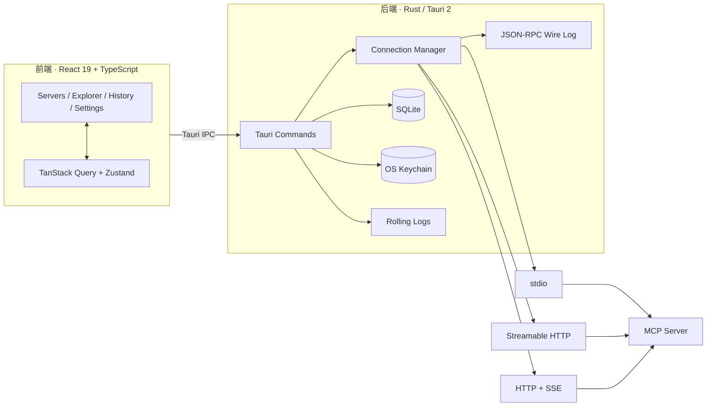

<div align="center">
  
</div>

<h1 align="center">MCP Tester</h1>

<p align="center">
  <strong>MCP 服务接口测试工具</strong><br />
  在桌面端连接任意 MCP Server，像调试 HTTP 接口一样浏览能力、填参调用、查看报文并重放历史。<br />
  <sub>A desktop MCP client for Windows — connect, explore, invoke, inspect, and replay.</sub>
</p>

<p align="center">
  <strong>简体中文</strong> · <a href="README.en.md">English</a>
</p>

<p align="center">
  <a href="https://tauri.app/"></a>
  <a href="https://react.dev/"></a>
  <a href="https://www.rust-lang.org/"></a>
  <a href="https://modelcontextprotocol.io/"></a>
  <a href="#系统要求"></a>
  <a href="../../releases"></a>
  <a href="LICENSE"></a>
</p>

<p align="center">
  <a href="#核心功能">核心功能</a> ·
  <a href="#快速开始">快速开始</a> ·
  <a href="#使用指南">使用指南</a> ·
  <a href="#启动配置">启动配置</a> ·
  <a href="#数据与便携模式">数据与便携模式</a> ·
  <a href="#安全设计">安全设计</a> ·
  <a href="#本地开发">本地开发</a>
</p>

MCP Tester 是一个面向 **Model Context Protocol（MCP）** 的桌面调试工具。它把服务器管理、接口枚举、Schema 表单调用、JSON-RPC 报文观察和调用历史重放放在同一个界面里，适合调试本地 `stdio` 服务、远程 `Streamable HTTP` 服务以及遗留 `HTTP + SSE` 服务。

> [!NOTE]
> 当前版本为 **v0.1.3**，以 Windows 为主要发布平台；项目仍在快速迭代中。

## 核心功能

| 模块 | 能力 |
| --- | --- |
| **服务器管理** | 添加、编辑、删除 `stdio`、`Streamable HTTP`、`HTTP + SSE` 服务器；连接、断开、重连、健康探测；保存前可「测试连接」，逐步查看握手、协议版本与接口数量。 |
| **接口浏览器** | 枚举 Tools、Resources、Resource Templates、Prompts；按名称、描述或 URI 搜索；服务端推送列表变更时自动刷新。 |
| **Schema 表单** | 根据工具的 `inputSchema` 生成表单，支持必填、类型、枚举校验；可切换原始 JSON 编辑；校验不通过时可显式选择「仍要发送」。 |
| **调用与取消** | 发起 `tools/call`、`resources/read`、`prompts/get`；在途调用可取消；资源模板自动提取并校验变量。 |
| **结果查看** | 按 MCP 内容块渲染文本、Markdown、图片、音频、资源、链接与结构化 JSON；提供「渲染 / 结构 / 原文」三视图与一键复制。 |
| **链路观察** | 事件面板把 JSON-RPC 请求与响应按 id 配对，展示耗时、大小与错误状态；支持按方法、关键词、仅错误筛选，支持暂停、跟随最新与导出。同时查看服务端通知和 stdio `stderr`。 |
| **历史与重放** | 调用记录落 SQLite；按服务器、方法、状态、关键词筛选；一键载入调用台重放；支持删除、清空与导出 JSON。 |
| **导入导出** | 识别 Claude Desktop / Cursor 的 `mcpServers` 与 VS Code 的 `servers` 格式；导出服务器配置时敏感值统一替换为占位符。 |
| **启动配置** | 通过 `mcptester.config.json` 预置服务器、默认服务器与自动连接；只补缺失项，不覆盖用户修改。 |
| **便携与安全** | 安装版凭据进入系统凭据库；便携模式数据随程序目录；日志字段级脱敏；超过 1 MB 的结果自动落盘。 |

几个设计目标：

- **可观察**：不只看调用结果，还能看到完整的 JSON-RPC 往返、通知和进程输出。
- **可复现**：参数与结果可回放，便于定位偶发问题和验证修复。
- **可迁移**：服务器配置可在 MCP Tester 与 Claude Desktop / Cursor / VS Code 的配置格式之间导入导出。

## 快速开始

### 下载安装

前往 [Releases](../../releases) 下载最新版本。

| 发行形态 | 适用场景 | 数据与凭据 |
| --- | --- | --- |
| **MSI 安装版** | 日常使用，支持标准安装与卸载 | 数据在系统用户目录；敏感值存入系统凭据库 |
| **便携版 ZIP** | 免安装、随身携带、隔离环境 | 数据在解压目录的 `data/`；敏感值明文保存在本地数据库 |

> [!WARNING]
> 便携版会把请求头、环境变量等敏感值以明文写入 `data/mcptester.db`。请勿把包含真实凭据的便携目录对外分发。当前 MSI 未做代码签名，首次运行时 Windows 可能显示 SmartScreen 提示。

### 系统要求

| 依赖 | 要求 |
| --- | --- |
| 操作系统 | Windows 10 / 11（x64） |
| WebView2 | Windows 11 已内置；Windows 10 可能需要安装 WebView2 Runtime |
| Node.js | 20 或更高版本 |
| pnpm | 9 或更高版本（仓库使用 `pnpm-lock.yaml`） |
| Rust | stable，需支持 edition 2024 |
| 构建工具 | Visual Studio Build Tools（勾选「使用 C++ 的桌面开发」） |

### 从源码运行

```bash
pnpm install
pnpm tauri dev
```

首次启动会下载并编译 Rust 依赖，耗时取决于网络和机器性能。

### 构建与便携版

```bash
pnpm build        # TypeScript 类型检查 + 前端构建
pnpm tauri build  # 生成 MSI
```

MSI 产物位于 `src-tauri/target/release/bundle/msi/`。

如需手动制作便携版：

```powershell
pnpm tauri build --no-bundle
# 复制 src-tauri/target/release/mcptester.exe 到目标目录
# 在同目录创建空文件 mcptester.portable 即启用便携模式
```

## 使用指南

### 1. 添加并连接服务器

- 在「服务器」页点击「新建服务器」。
- `stdio`：填写命令、参数（每行一个）、环境变量和工作目录。命令解析方式建议保持 `resolve`；`cmd_shell` 存在转义风险；`never` 主要用于排障。
- `HTTP / SSE`：填写 MCP 端点 URL、请求头、超时覆盖；仅本地自签证书场景才建议勾选「允许不安全 TLS」。
- `Authorization` 请求头同时支持完整写法（`Bearer xxx`）和仅 token（`xxx`），客户端会统一归一化。
- 「测试连接」只验证配置，不保存、不写历史；保存后点击「连接」，再到「接口」页枚举能力。

### 2. 浏览与调用接口

- 进入「接口」页，选择已连接的服务器，必要时点击「刷新接口」。
- 顶部页签分别对应 Tools、Resources、Resource Templates、Prompts，左侧列表支持关键字搜索。
- 调用工具时，表单会依据 JSON Schema 生成；也可以切换到 JSON 模式直接编辑参数。
- 必填项缺失或类型不符时默认拦截发送，可显式点击「仍要发送」跳过前端校验；JSON 解析失败时不会提供该选项。
- 资源模板会自动提取 `{变量}`，填写完整后才能读取；在途调用可以点击「取消」。

### 3. 查看结果

- 结果头部展示状态、耗时、协议版本、传输类型、时间和大小。
- 「渲染」按 MCP 内容块展示；「结构」提供 JSON 树；「原文」保留原始响应。
- 结果超过 1 MB 时数据库只保留前 1 MB，完整内容落在 `data/results/<record-id>.json`，可在结果区打开。

### 4. 观察链路

- 在接口页底部展开「事件面板」。
- 「报文」页签按 JSON-RPC id 配对请求与响应，显示方向、耗时、大小和状态，可按方法、关键词或「仅错误」筛选。
- 支持暂停、跟随最新、清空与导出；服务端通知和 stdio `stderr` 分别位于独立页签。
- 服务端发送 `*/list_changed` 通知时，接口列表会自动刷新。

### 5. 历史与重放

- 「历史」页记录每次工具调用、资源读取、提示词获取和探测。
- 可按服务器、方法、状态、关键词筛选，查看完整参数与结果。
- 点击「载入调用台重放」会回到接口页，自动定位服务器、接口并回填参数。
- 支持删除单条、按当前筛选清空以及导出 JSON；保留天数与最大条数可在设置页调整。

### 6. 导入与导出

- 导入支持 **Claude Desktop / Cursor** 的 `{ "mcpServers": { ... } }` 和 **VS Code** 的 `{ "servers": { ... } }`。
- 可以从文件导入，也可以直接粘贴 JSON。
- 导入时按「键名优先 + 值模式兜底」识别敏感项；安装版写入系统凭据库，便携版随数据目录保存。
- 导出支持 `claude` 与 `vscode` 两种格式，所有敏感值统一替换为 `${MCPTESTER_SECRET}`。

## 启动配置

可以在程序启动时预置服务器。示例文件见 [`mcptester.config.example.json`](mcptester.config.example.json)：

```json
{
  "mcptester": {
    "version": 1,
    "autoConnect": true,
    "defaultServer": "local-dev",
    "secretHeaders": ["X-Custom-Token"],
    "secretEnv": []
  },
  "servers": {
    "local-dev": {
      "name": "本地开发",
      "type": "http",
      "url": "http://127.0.0.1:8080/mcp",
      "headers": {
        "Authorization": "Bearer ${MCPTESTER_SECRET}"
      },
      "timeout_secs": 30
    },
    "filesystem": {
      "name": "本地文件系统",
      "type": "stdio",
      "command": "npx",
      "args": ["-y", "@modelcontextprotocol/server-filesystem", "D:\\data"],
      "env": {},
      "shell_wrap": "resolve"
    }
  }
}
```

**查找顺序**

1. 命令行参数 `--config <path>`
2. 环境变量 `MCPTESTER_CONFIG`
3. 可执行文件所在目录下的 `mcptester.config.json`
4. 数据目录下的 `mcptester.config.json`
5. Tauri 资源目录下的 `mcptester.config.json`

**应用规则**

- 只补充尚未应用过的服务器，**永不覆盖**已有配置。
- 已删除的预置服务器不会自动复活；可在设置页点击「重新应用配置」补回缺失项。
- `autoConnect` 与 `defaultServer` 只在首次 seed 或手动重新应用时生效。
- `secretHeaders` / `secretEnv` 用于把额外的键名标记为敏感项；值写成 `${MCPTESTER_SECRET}` 表示「待配置」，不会写入数据库或凭据库。
- 由配置文件预置的服务器，其请求头和环境变量会以明文保存在本地 SQLite；导出时仍会脱敏。

> [!IMPORTANT]
> 不要把含真实凭据的 `mcptester.config.json` 提交到版本库。仓库中的 `.gitignore` 已忽略该文件，仅保留示例文件。

## 数据与便携模式

| 模式 | 触发方式 | 数据目录 | 凭据存储 |
| --- | --- | --- | --- |
| **安装模式** | 默认 | `%APPDATA%\com.mcptester.desktop` | 系统凭据库 |
| **便携模式** | 可执行文件旁存在 `mcptester.portable` | `<程序目录>\data` | 本地数据库明文 |
| **自定义目录** | 设置 `MCPTESTER_DATA_DIR` | 指定目录（相对路径按程序目录解析） | 由便携标记决定 |

如果便携目录不可写，应用会回退到用户数据目录，并在设置页提示本次运行未启用便携凭据策略。

常见文件：

| 路径 | 内容 |
| --- | --- |
| `mcptester.db` | 服务器配置、设置、调用历史元数据 |
| `results/` | 超过 1 MB 的完整调用结果 |
| `logs/` | 按天滚动的运行日志 |
| `mcptester.config.json` | 可选的启动配置 |

安装模式的日志默认位于 `%LOCALAPPDATA%\com.mcptester.desktop\logs`；完整路径以设置页显示为准。

## 安全设计

- **凭据隔离**：安装模式下敏感请求头和环境变量写入操作系统凭据库（Windows Credential Manager / macOS Keychain / Linux Secret Service），SQLite 只保存引用索引。
- **掩码编辑**：界面只展示 `Beare****5678` 形式的掩码；编辑时留空表示不修改，输入新值才会替换，避免把掩码误写回凭据库。
- **导出脱敏**：导出服务器配置时，敏感值统一替换为 `${MCPTESTER_SECRET}`，不会带出明文。历史记录导出保留原始请求与响应，分享前请自行确认其中是否包含敏感数据。
- **日志脱敏**：按精确字段名匹配敏感字段，并对 Bearer Token、JWT、`sk-` 密钥、URL token 参数和 URL userinfo 做值模式打码；`stderr` 与通知只进入内存缓冲，不写入日志文件。
- **本机优先**：应用不包含遥测或云端同步，服务器配置、调用历史和响应内容只保存在本机。
- **显式风险开关**：「允许不安全 TLS」仅用于本地自签证书，默认关闭；便携模式的明文凭据风险会在界面中明确提示。

## 协议支持

| 世代 | 协议版本 | 协商方式 |
| --- | --- | --- |
| **现代世代** | `2026-07-28` | `server/discover` |
| **旧世代** | `2025-11-25`、`2025-06-18`、`2025-03-26`、`2024-11-05` | `initialize` 握手 |

默认自动协商：优先尝试现代世代，失败后回退到最新的旧世代版本。也可以在服务器配置中固定 `2026-07-28` 或 `2025-11-25`。

已支持的交互包括：

- `tools/list`、`tools/call`
- `resources/list`、`resources/read`、`resources/templates/list`
- `prompts/list`、`prompts/get`
- `subscriptions/listen`（现代世代列表变更通知）
- 旧世代 `ping` 健康探测；现代世代使用幂等枚举探测
- 调用取消与在途请求中止

> [!NOTE]
> `HTTP + SSE` 是 MCP 规范中已弃用的旧传输，仅为兼容旧服务器保留。新项目建议使用 `Streamable HTTP`。

## 技术架构



| 层 | 选型 |
| --- | --- |
| 桌面框架 | Tauri 2 |
| 前端 | React 19、TypeScript、Vite、Tailwind CSS |
| 路由与状态 | React Router、TanStack Query、Zustand |
| 后端 | Rust 2024、Tokio、rmcp 3.5 |
| 存储 | SQLite（rusqlite，bundled） |
| 凭据 | keyring-core + 平台原生凭据库 |
| 日志 | tracing + tracing-appender（按天滚动） |
| 测试 | Vitest、Testing Library、cargo test、内置 mock MCP server |

## 本地开发

### 质量校验

```bash
pnpm lint
pnpm test

cd src-tauri
cargo test --features mock-server
cargo clippy --all-targets
```

### 内置 Mock Server

仓库自带一个确定性的 mock MCP 服务器，覆盖工具调用、资源、资源模板、提示词、列表变更通知和双世代协商。

```bash
cd src-tauri
cargo run --features mock-server --bin mock-mcp-server -- --transport http --port 18080
```

然后在应用中添加服务器，URL 填 `http://127.0.0.1:18080/mcp`。

常用参数：

- `--transport stdio|http|sse`
- `--era both|modern|legacy`
- `--port 18080`
- `--fastmcp-compat --token mock-token`：模拟 FastMCP / Python 服务端的鉴权与会话行为

### Probe CLI

不启动桌面界面时，可以用 `probe` 直接连接并调用：

```bash
cd src-tauri
cargo run --bin probe -- \
  --http http://127.0.0.1:18080/mcp \
  --tool echo \
  --args '{"text":"hello"}'
```

`--stdio` 模式可用于调试本地进程型服务器。

## 项目结构

```text
.
├─ src/                         # React 前端
│  ├─ pages/                    # 服务器 / 接口 / 历史 / 设置
│  ├─ components/               # Schema 表单、结果与报文查看器、事件面板
│  ├─ api/                      # Tauri IPC 封装
│  ├─ stores/                   # 重放与 Toast 状态
│  └─ i18n/                     # 中文文案
├─ src-tauri/
│  ├─ src/mcp/                  # 连接、传输、模型、报文日志
│  ├─ src/commands/             # Tauri 命令
│  ├─ src/storage/              # SQLite 仓储与迁移
│  ├─ src/bootstrap/            # 目录解析、启动配置
│  ├─ src/bin/                  # mock-mcp-server / probe
│  └─ tests/                    # MCP 客户端集成测试
├─ LICENSE
├─ mcptester.config.example.json
├─ package.json
├─ README.md
└─ README.en.md
```

## 已知限制

- 当前仅配置并发布 Windows MSI；macOS / Linux 的代码路径尚未打包验证。
- 界面文案目前只有中文，`i18n` 目录已为多语言预留结构。
- 掉线后的自动重连尚未内置，当前通过服务器列表中的「重连」按钮恢复。
- 超过 1 MB 的调用结果在数据库中只保留前 1 MB，完整内容需从 `results/` 打开。
- 旧版 `HTTP + SSE` 传输仅用于兼容，部分新服务器可能不再支持。

## Roadmap

- [ ] macOS / Linux 打包与签名
- [ ] 自动重连与连接保活
- [ ] 英文界面
- [ ] 调用用例与集合管理
- [ ] CI 与自动发布

## 许可证

本项目基于 [MIT License](LICENSE) 开源。

Copyright © 2026 alex2026a
